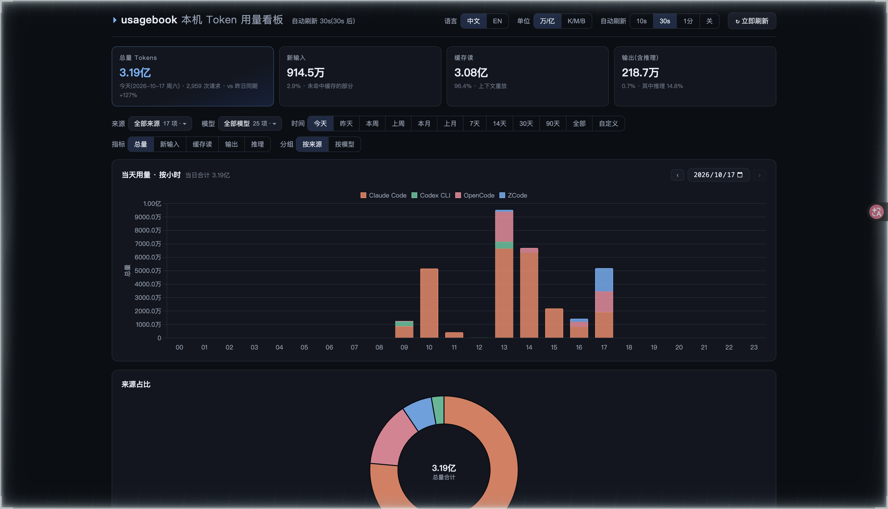

# usagebook

[English](README.en.md) | **简体中文**

[](https://github.com/jgsliu7/usagebook/actions/workflows/ci.yml)
[](LICENSE)

中文优先、零配置、跨工具的 **AI 编程 token 用量统计与本地看板**：只读解析各 AI 编程工具落盘在本地的数据，统一口径算清"token 花在哪"。

## 界面语言

看板支持 **简体中文与 English**：header 的 `中文 / EN` 切换，选择按浏览器记忆；非中英浏览器默认 English。终端 CLI 输出当前为中文（多语言在路线图中）。

> 注：`docs/数据源档案/` 为中文文档；日期选择控件跟随浏览器语言，不跟随界面语言。



## 支持的数据源

v0.1 统计 24 种 AI 编程工具的 token 消耗。**首发以 macOS 为主；Linux 可从源码构建；Windows 暂不可用（自动测试未通过，暂无发行包）**，部分来源也有平台限制。各数据源的格式规范见 `docs/数据源档案/`：

| 数据源 | 状态 | 说明 |
|---|---|---|
| Claude Code | ✅ | 会话转录 + 源自带金额（不等于实际账单） |
| Codex CLI | ✅ | 会话事件流 |
| Kimi Code | ✅ | 双根双格式会话流 |
| ZCode | ✅ | SQLite 用量账本 |
| WorkBuddy | ✅ | 会话转录 + 用量行 |
| DeepSeek Harness | ✅ | 压缩会话流(zstd) |
| MiniMax | ✅ | SQLite 用量投影 |
| OMP / Pi | ✅ | 会话流(OMP 自带逐请求成本) |
| Cline | ✅ | 仅原生会话(导入镜像不计) |
| OpenCode | ✅ | SQLite 消息库 |
| Qwen Code | ✅ | 逐响应用量 + 月度通道 |
| Gemini CLI | 🧪 | 会话 JSONL/JSON |
| Copilot CLI | ✅ | 逐请求用量表 |
| Goose | ✅ | SQLite 逐请求账本 |
| Kilo Code | ✅ | SQLite 消息库 |
| Hermes | ✅ | SQLite 会话统计 |
| OpenClaw | ✅ | SQLite 事件流 |
| Grok Build / Amp / Codebuff / Droid / Qoder | 🧪 | 依上游源码与文档实现,未实机验证 |
| Roo Code | 🧪 | 任务消息文件(产品已停运,存量数据) |
| Kiro | ⏸ | 该工具本地不落 token 计数,暂不支持 |

✅ = 有真实安装数据，逐位对账验证；🧪 = 依上游源码与官方文档实现，未经真实安装验证（合成样本测试尚覆盖不全，逐源验证状态见各档案）；⏸ = 暂停支持。分级依据见 `docs/数据源档案/29-源可信度评级报告.md`。


## 快速开始

macOS 从源码安装（需要 Rust 和 Xcode Command Line Tools）：

```bash
git clone https://github.com/jgsliu7/usagebook && cd usagebook
sh install.sh && "$HOME/.local/bin/usagebook" serve --open
```

也可以从 [GitHub Releases](https://github.com/jgsliu7/usagebook/releases) 下载预编译发行包（当前提供 macOS 通用包与 Linux x86_64 包；Windows 暂无）：完整解压后运行其中的 `sh install.sh`，不需要 Rust。

看板只在 `127.0.0.1:7878` 提供服务；按 **Ctrl-C** 停止。安装脚本不需要 sudo，不修改 shell 配置，不注册后台服务。已有源码并位于仓库根目录时，复制上面的第二行即可安装并打开看板。关闭浏览器标签页不会停止服务；下次使用仍运行 `"$HOME/.local/bin/usagebook" serve --open`。

## 安装

完整步骤、安装目录、更新与卸载见 [INSTALL.md](INSTALL.md)。也可以把本仓库交给 AI 编程助手，要求按该文档安装；以实际运行结果为准，发现数据目录不代表已有可统计的记录。

## 构建

```bash
cargo build --release --locked # 首次会下载依赖；SQLite/zstd 随源码构建
./target/release/usagebook --help
```

源码要求 Rust 1.85+ 与 C 编译工具；最低版本由 CI 单独检查。预编译包运行时不需要 Rust、Node 或系统 SQLite。

## 用法

```bash
usagebook                          # 全源扫描 + 按日/工具/模型报表
usagebook --days 7 --json          # JSON 输出(脚本消费,与报表同口径)
usagebook --source claude          # 只看 Claude Code
usagebook --days 7                 # 最近 7 天
usagebook --source codex --max-files 50   # 抽样调试
usagebook doctor                   # 目录发现自检:根在哪/体积多大
usagebook doctor --check           # 进一步检查解析结果（大目录需要等待）
usagebook serve                    # 本地看板 → http://127.0.0.1:7878
usagebook serve --open             # 启动成功后打开看板
usagebook serve --port 8080 --refresh-secs 30
```

`--refresh-secs` 是没有页面轮询时的回退重扫间隔；看板开着时，右上角"自动刷新"档位会直接驱动服务端按同节奏重扫（停止轮询后回退到该值）。

看板能力：

- **时间窗**：打开默认"今天"（不跨刷新记忆）；一键切换 今天 / 昨天 / 本周 / 上周 / 本月 / 上月 / 7天 / 14天 / 30天 / 90天 / 全部 / 自定义，自然周（周一~周日）与自然月（1号~月末）为一等档位
- **周期趋势**：选中"本周/上周"附最近 10 个自然周趋势，选中"本月/上月"附最近 12 个自然月趋势；当前期高亮，点击历史柱钻取该期按天明细
- **钻取**：点击柱子或日期选择器进入任意一天，‹ › 前后翻页
- **筛选**：来源 / 模型双多选下拉（搜索 / 全选 / 全不选；数字跟随当前时间窗，点击明细行切换，选择按浏览器记忆）
- **占比环**：跟随当前分组（来源 / 模型）切换，环心显示合计，图例带百分比
- **汇总卡片**：随时间窗与筛选联动，附总量环比——今天比较昨日同期（截至本轮扫描时刻）；本周/本月比较完整的上周/上月并明确标注；历史周/月比较完整前期；近 N 天比较前 N 天
- **五桶指标切换**：缓存写占全量 token 不足 0.1% 时自动隐藏该指标
- **单位制**：万/亿 ↔ K/M/B 中英文切换，坐标轴与悬浮提示统一
- **自动刷新**：10s / 30s / 1分 / 关，可选档位
- **快照磁盘缓存**：服务重启先显示缓存结果，后台重扫更新
- 图表库 Chart.js 随二进制分发，零外网依赖

边界说明：图表的指标切换不改变"总量 Tokens"卡片及其环比的总量口径；今日同期不可计算或缓存仍属于前一天时，不显示该环比；整轮扫描或连接失败时，已有结果继续展示并标出数据截止时间；单个来源扫描失败会另行提示，本轮统计可能不完整；明细表跟随时间窗，来源表按带金额的逐请求记录汇总，金额覆盖可能不完整。

### 环境变量

| 变量 | 作用 | 默认 |
|---|---|---|
| `USAGEBOOK_DATA_DIR` | usagebook 自己的缓存目录(不会改变任何工具的原始日志目录) | `~/.usagebook` |
| `USAGEBOOK_INCREMENTAL` | 设为 `off` 停用增量缓存,退回每次全量扫描 | 开启 |
| `USAGEBOOK_STATE_DB` | 状态库逻辑基址(诊断与高级用法)，实际文件位于按代次派生的目录 | `<DATA_DIR>/state.db` |
| `USAGEBOOK_LOG_DIR` | 运行日志目录;设为 `off` 关闭文件日志 | `<DATA_DIR>/logs` |
| `USAGEBOOK_LOG_KEEP_DAYS` | 日志保留天数 | `14` |
| `USAGEBOOK_LOG_MAX_TOTAL` | 日志目录总量上限(字节) | `209715200`(200MiB) |

各数据源自己的目录覆盖变量，以 `usagebook doctor` 的展示与各源档案为准。

usagebook 在自己的本地缓存目录保存扫描加速状态，默认位于 `~/.usagebook/` 下按兼容代次命名的子目录（如 `state.db.cache-p6-s2-l1/state.db`）。它仅包含**文件路径**、缓存修订号与白名单用量元数据（模型名、会话标识、token 计数、消息标识、时间戳），**不含任何提示词、工具调用或代码内容**；纯本地，零网络。设置 `USAGEBOOK_INCREMENTAL=off` 可完全停用并退回全量扫描；`usagebook doctor` 显示实际状态库路径及健康信息。

状态库按解析语义与锁协议的兼容代次隔离：兼容的应用版本共享同一目录，代次变更后首轮重新扫描。`USAGEBOOK_STATE_DB` 是逻辑基址，设为 `/x/custom.db` 时实际文件为 `/x/custom.db.cache-p6-s2-l1/state.db`。旧目录不会被读取、迁移或清理；目录旁的同名 `.lock` 文件是生命周期锁，正常使用期间不要删除。

### 运行日志

`serve`(本地看板)会把**运行日志**写入 `~/.usagebook/logs/`(目录 0700、文件 0600,一次性命令不写文件日志):

- **记什么**:文件路径(已缩略家目录为 `~`)、来源/模型名、时间戳、计数与耗时——这些组合会反映"何时在用哪些 AI 工具"的使用行为侧写;
- **不记什么**:对话内容、任何凭据(API key/token/cookie)、原始会话行;报错只含计数/路径/错误码;
- **保留与上限**:按"日期 + 大小"双重滚动(单文件 20MiB),默认保留 14 天、目录总量封顶 200MiB(当日与跨零点活动文件除外,各至多 20MiB),进程自动清理,不需要 logrotate;崩溃另留档于同目录 `panic.log`;
- **关闭**:`USAGEBOOK_LOG_DIR=off`(或调整保留天数/总量上限,见上表);
- **删除**:`rm -rf ~/.usagebook/logs` 随时可删,不影响任何统计(真相在源文件)。

排查问题:把该目录附给维护者即可(先自行脱敏——路径可能暴露用户名与项目名);`RUST_LOG=usagebook_core=debug` 可临时调高诊断级别(显式设置后该变量完全接管,人机提示与文件层可能出现同一消息两份;如需同时保留看板每轮摘要,用 `RUST_LOG=usagebook_core=debug,usagebook_cli=info`);`-v/-vv` 只提升终端输出级别。已知边界:① 日志目录不支持网络文件系统(NFS/SMB)与多人共享目录;② 同时开两个 `serve`(不同端口)时,第二个实例的文件日志自动降级,看板不受影响,极端竞态窗口内可能出现行交错(可恢复,真相在源文件);③ 系统时钟回拨后当日日志可能落在"未来日期"的文件名里,不影响内容;④ 跨重启当日分片若被外部清空,分片序号可能从 001 重新计起;⑤ 磁盘写满等极端故障使轮转长期失败时,占用上界由"连续写失败自动停写文件层"兜底,而非 200MiB 封顶。

## License

Apache-2.0,见 [LICENSE](LICENSE)。内嵌图表库与 Rust 依赖的来源、版权和许可全文见 [THIRD_PARTY_LICENSES.md](THIRD_PARTY_LICENSES.md)。

## 更新

本工具**自身不联网检查更新**(隐私承诺:零外呼,见 SECURITY.md)。获取新版本:

```bash
# 先在看板终端按 Ctrl-C，然后在源码目录更新并重新安装
git pull
sh install.sh
"$HOME/.local/bin/usagebook" serve --open
```

发行包用户在完整解压的新包中重新运行 `sh install.sh`。Homebrew/crates.io 安装渠道尚未提供，不要假设同名包属于本项目。

安装后运行 `usagebook --version` 查看版本；各版本变更见 `CHANGELOG.md`。版本策略：0.x 阶段遵循 semver，但次版本仍可能包含破坏性变更；本地状态库由 schema 守卫自动处理(升级/降级行为见 [INSTALL.md](INSTALL.md))，不承诺跨版本缓存兼容。

## 免责声明

- 本工具只**读取**本地已有文件做统计，不修改任何工具的数据；运行时不向外网发送请求
- **统计范围取决于当前仍可读取的日志**。源工具删除或清理日志后，后续统计可能减少；快照只是启动缓存，不是永久账本或会话备份
- 与所列各 AI 编程工具无隶属关系;各工具名称与商标归其各自所有者

## 术语速查

- **五桶**:每个请求的 token 拆成 新输入 / 缓存读 / 缓存写 / 输出 / 推理 五个互斥桶
- **用语对照**:看板界面用通俗词——「用量分类」即本表的「五桶」,「跨工具可比」即本表的「口径归一」;文档用技术词,两者一一对应
- **口径**:request_delta(单请求增量)与 session_total(会话累计快照)两种记账方式,报表只累计前者
- **inclusive/exclusive**:某些工具的"输入"字段含缓存部分(需减除归一),某些不含——逐源依据见数据源档案

## 用法说明

示例中的 `usagebook` 指安装脚本生成的 `~/.local/bin/usagebook`（需在 PATH 中），或构建产物 `./target/release/usagebook`。也支持从仓库根目录执行 `cargo install --path crates/usagebook-cli --locked`，安装到 Cargo 的可执行目录。

## 口径纪律

- **金额来自源记录及适配器已有换算，仅供参考，不等同于实际账单或订阅费用**。看板只汇总窗口内带金额的逐请求记录，可能仅覆盖一部分请求；Claude 会话级金额不计入该列。显示 `—` 或隐藏金额列不代表免费：当前聚合尚不能完整区分未提供金额、真实零值和部分覆盖，不可据此对账
- 源支持等级:标 ✅ 的为实机验证;未标记的源装了但无数据,通常是当前环境没有该工具的记录或其格式尚未支持,先运行 `usagebook doctor` 排查

- 五桶模型:输入(新)/ 缓存读 / 缓存写 / 输出 / 推理输出
- `request_delta`(单请求增量)与 `session_total`(会话累计)不可混加;报表只对前者求和
- 未知行类型 / 坏行一律计数上报,禁止静默吞掉;解析不得猜测规范未覆盖的字段
- inclusive 语义源(Codex / ZCode / WorkBuddy / Cline 的原始 input 含缓存)一律在适配器内减除归一为 exclusive

## 架构(贡献者向)

```
usagebook-core(内核)
├── model.rs      统一用量模型:UsageRecord(五桶+口径+成本+去重键)、UsageSource 协议
├── sources/      每个数据源一个文件(claude/codex/kimi/…),互不依赖
├── common.rs     跨源工具:环境变量多根、递归发现、时间转换、流式行读
├── store/        增量状态库(SQLite:游标持久化、锁协议、损坏轮转与封顶清理)
├── logging.rs    运行日志(脱敏闸门、日期+大小滚动、上限自动清理)
├── snapshot.rs   快照聚合(小时桶;看板与终端报表共用,含磁盘缓存热启动)
└── report.rs     终端报表聚合 + JSON
usagebook-cli(外壳)
├── main.rs       入口(默认=全量扫描报表;子命令 serve/doctor)
└── serve.rs      看板 HTTP 编排(扫描线程 + 快照磁盘缓存)
```

新增数据源 = `sources/` 加一个实现 `UsageSource` 的文件 + `lib.rs` 注册一行 + `SOURCE_CATALOG` 元数据一行(有单元测试保证两处不漂移)。每个源的解析规范见 `docs/数据源档案/<NN>-<源>.md`;`scan_roots(roots, ..)` 是纯函数核,可用目录 fixture 直接测试,不依赖真实安装。

## 文档地图

- `INSTALL.md` — 安装与故障排查(AI 可执行格式)
- `CONTRIBUTING.md` — 如何添加新数据源(5 步)
- `docs/数据源档案/00-总览.md` — 数据源规范总入口(统一用量模型/档案索引)
- `docs/数据源档案/29-源可信度评级报告.md` — 各源可信度评级
- `CHANGELOG.md` / `SECURITY.md` / `LICENSE`(Apache-2.0)
